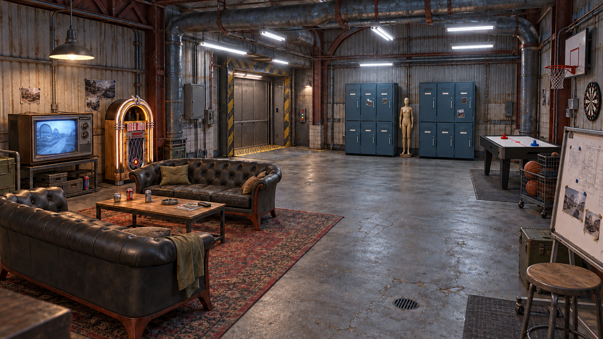
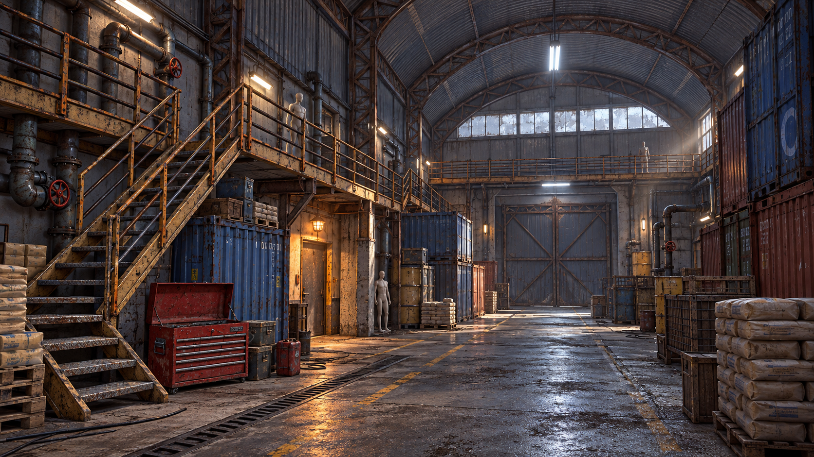
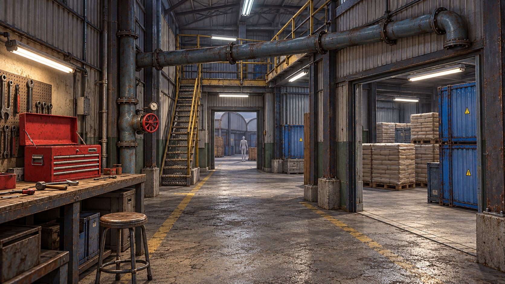

# Friendslop — концепты по изображениям выбранных ассетов

Созданы 10 октября 2026 года встроенным **image_gen** с официальными превью моделей в качестве входных изображений. В отличие от предыдущих концептов, генератор получил конкретные изображения объектов: дивана, TV, шкафчиков, автомата, труб, мостков и ящика для инструментов.

Это визуализации предлагаемой сборки. 3D-пакеты не скачивались и не импортировались в Unity в рамках этой задачи; изображения не являются рендерами точных mesh/material файлов. Генератор интерпретирует геометрию, масштаб и степень износа. При сборке сцен используются исходные модели с их реальными ограничениями.

## Лобби

Светлая социальная раздевалка: зона отдыха слева, шкафчики и лифт в глубине, развлечения справа, свободный центр. Формы дивана, телевизора, шкафчиков и музыкального автомата привязаны к конкретным превью.

| Объект | Реальный источник | Что перенесено в концепт |
| --- | --- | --- |
| Оболочка комнаты | [Industrial Set v3.0](https://assetstore.unity.com/packages/3d/environments/industrial/rpg-fps-game-assets-for-pc-mobile-industrial-set-v3-0-101429) | Гофрированный металл, стальные опоры, бетонные основания, промышленная палитра |
| Диваны | [Sofa 02 — Poly Haven](https://polyhaven.com/a/sofa_02) | Чёрная кожа с утяжками, округлые подлокотники, деревянное основание |
| TV | [Television 01 — Poly Haven](https://polyhaven.com/a/Television_01) | Корпус CRT, две ручки справа, нижняя решётка динамика |
| Шкафчики | [LOCK 3 — Innerscene](https://www.innerscene.com/tools/library/3d-parts/lock-3-office-locker-bank-c5ce4b13) | Синий банк из трёх колонок и двух рядов дверей; две копии вдоль стены |
| Автомат | [Jukebox — olesk](https://blendswap.com/blend/7373) | Деревянный корпус, хромированная арка, звёзды, ромбовидная решётка |

Лифт, столик, аэрохоккей, кольцо, доска, ковёр и мелкий реквизит представлены как предлагаемые дополнения. Их точные модели не подтверждены этими пятью входными ассетами. Двери шкафчиков и материалы автомата требуют подготовки, описанной в основной подборке. Два банка дают двенадцать отделений: распределение под шесть игроков нужно адаптировать к существующей системе владельцев.

## Цех / складской ангар

Арочная оболочка ангара, контейнеры и мешки следуют превью Industrial Set. [Modular Industrial Catwalk Kit](https://assetstore.unity.com/packages/3d/props/industrial/modular-industrial-catwalk-kit-free-287064) задаёт форму лестницы, вертикальных охристых стоек и тёмных горизонтальных перил. Трубы с красными вентилями опираются на [Modular Industrial Pipes 01](https://polyhaven.com/a/modular_industrial_pipes_01), красный ящик — на [Metal Tool Chest](https://polyhaven.com/a/metal_tool_chest).

Широкий нижний проход, боковые укрытия и верхний маршрут позволяют использовать тот же набор для разных комнат. Внутренняя компоновка и освещение предложены для игры; наличие каждого показанного строительного узла в пакете ещё нужно проверить при импорте.

## Техническая зона / мастерская

Те же четыре источника в более тесной зоне: мастерская слева, склад справа, лестница и переход к ангару впереди. Красный ящик и вентиль дают заметные ориентиры. Верстак, табурет и размещение ручных инструментов интерпретированы как простой дополнительный реквизит.

## Исходники

- [Полные промпты трёх концептов](prompts.json).
- [Параметры генерации, входные изображения и локальная правка аэрохоккея](generation.json).
- [Официальные URL использованных превью](../AssetReferences/sources.json).
- [Основная подборка и подготовка ассетов для Unity](../../../Industrial-set-3-art-direction.md).

Предыдущие концепты v1 сохранены. Сцены, скрипты, FishNet и EOS этой задачей не изменялись.
