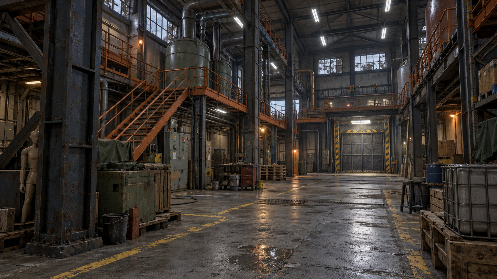
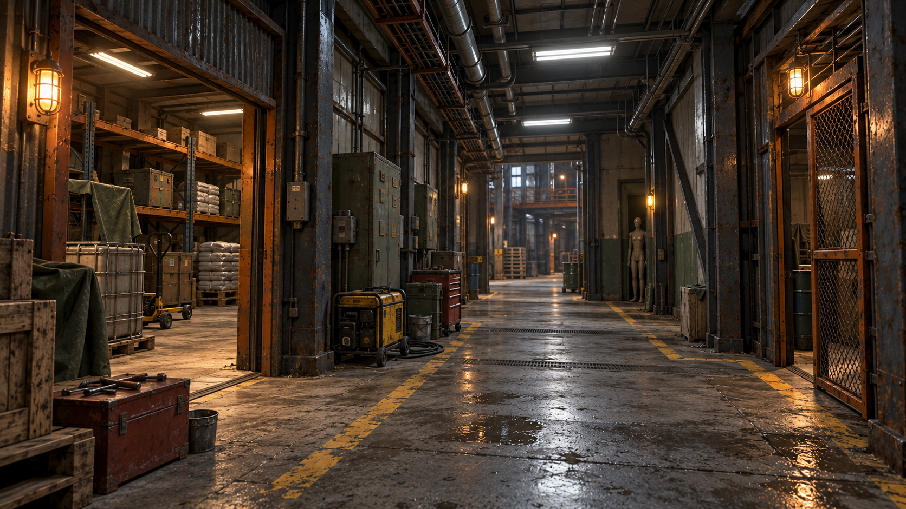
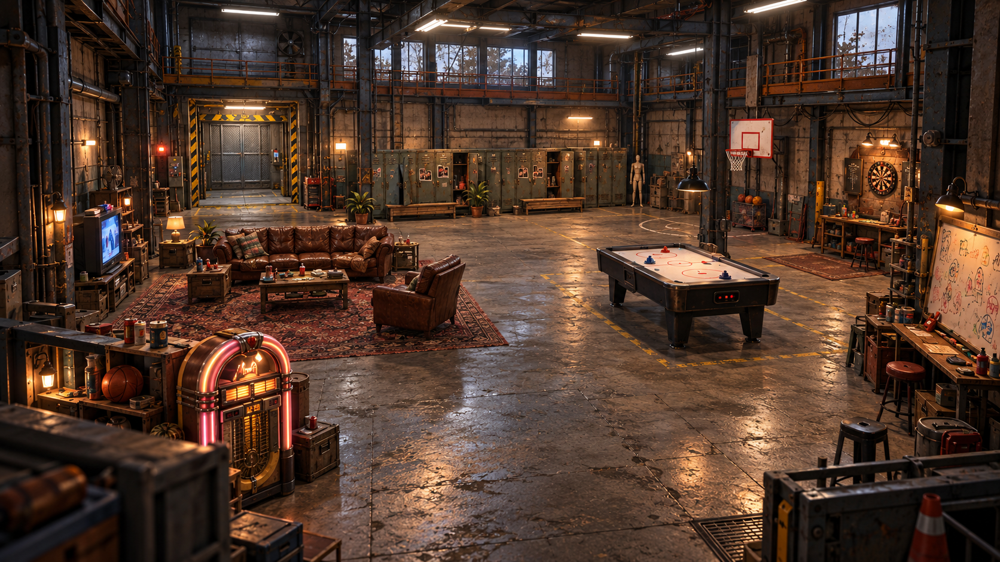

# Friendslop: окружение на основе Industrial Set 3.0

Подборка проверена 10 октября 2026 года. Основной набор — **Industrial Set v3.0**. Звуковые ассеты не подбирались: используем существующие звуки проекта. Модели пока не скачивались и не импортировались; совместимость с Unity 6000.6.2f1 / URP нужно проверить на небольшой тестовой сцене.

## Основной набор и дополняющие паки

| Набор | Куда применить | Бесплатность / подготовка |
| --- | --- | --- |
| [Industrial Set v3.0 — Dmitrii Kutsenko](https://assetstore.unity.com/packages/3d/environments/industrial/rpg-fps-game-assets-for-pc-mobile-industrial-set-v3-0-101429) | Основная архитектура комплекса: ангары, опоры, трубы, контейнеры, паллеты, вентиляторы. Из его деталей собирать цехи и оболочку лобби. | FREE, Standard Unity Asset Store EULA. Более 150 элементов. Хотя таблица указывает URP, автор отдельно требует конвертацию материалов; это не гарантия готовности для Unity 6. |
| [Modular Industrial Catwalk Kit — Free](https://assetstore.unity.com/packages/3d/props/industrial/modular-industrial-catwalk-kit-free-287064) | Мостки, лестницы и второй маршрут над цехом. Оранжевые перила сделать узнаваемым ориентиром завода. | FREE, Standard Unity Asset Store EULA. Бесплатная версия: 11 модулей, 4 LOD. Заявлена поддержка URP для Unity 2021.3.8. Цвета и дополнительные элементы платной версии в подборку не входят. |
| [Industrial Props Kit — Universal Assets](https://assetstore.unity.com/packages/3d/props/industrial/industrial-props-kit-84745) | Небольшие технические площадки, ограждения и заводской реквизит. Брать отдельные модели, дополняющие основу. | FREE, Standard Unity Asset Store EULA. Старый пакет для Unity 5.3.4: материалы и коллайдеры проверить, готовность для URP не заявляем. |
| [Modular Industrial Pipes 01 — Poly Haven](https://polyhaven.com/a/modular_industrial_pipes_01) | Повторяемые трубопроводы во всех помещениях; добавлять там, где не хватает деталей основной коллекции. | CC0. Модульный набор моделей; материалы собрать под URP. |
| [Modular Electric Cables — Poly Haven](https://polyhaven.com/a/modular_electric_cables) | Кабели, соединения и проводка между цехами, лифтом и лобби. | CC0. Дополнительный модульный набор; не дублировать его деталями уже достаточную геометрию основы. |
| [The Shed — коллекция Poly Haven](https://blog.polyhaven.com/the-shed/) | Мастерская и бытовой реквизит: инструменты, рабочие места, небольшие предметы для поиска и бросков. | Модели Poly Haven — CC0. Это коллекция отдельных загрузок, не готовый Unity-пакет. Выбирать только нужные модели. [Лицензия](https://polyhaven.com/license). |
| [Modular Sewer Asset Pack — RotoPoly](https://rotopoly.itch.io/sewers-modular-assets) | Дополнительная нижняя зона: подвалы и служебные тоннели. | Бесплатно / CC0, 54 детали, glTF и Blender. Согласовать сетку: большинство модулей 4 × 4 м. Использовать для отдельной зоны с едиными материалами, а не вперемешку с каждой стеной цеха. |
| [Old LowPoly premium Furniture — Creation Forge](https://assetstore.unity.com/packages/3d/environments/historic/old-lowpoly-premium-furniture-283804) | Дополнительная мебель для комнаты охраны, подсобок и старого офиса. | FREE, Standard Unity Asset Store EULA; заявлен URP для Unity 6000.5.5. Более стилизованная мебель: второстепенный набор, подогнать материалы и проверить рядом с Industrial Set. Для основного дивана предпочтительнее Sofa 02 ниже. |

## Точечные дополнения для лобби

Эти позиции — отдельные модели, а не большие паки.

| Модель | Назначение и подготовка |
| --- | --- |
| [Sofa 02 — Poly Haven](https://polyhaven.com/a/sofa_02) | CC0, старый кожаный диван, около 3 тысяч треугольников. Основа зоны отдыха. |
| [Television 01 — Poly Haven](https://polyhaven.com/a/Television_01) | CC0, деревянный CRT. Экран подключить к существующему VideoPlayer/RenderTexture, звук и сетевое состояние — к компонентам игры. |
| [Industrial Coffee Table — Poly Haven](https://polyhaven.com/a/industrial_coffee_table) | CC0, стол из дерева и металла. Исходник около 41 тысячи треугольников: сначала упростить/сделать LOD; для прототипа подойдёт простой стол с теми же материалами. |
| [LOCK 3 — Innerscene](https://www.innerscene.com/tools/library/3d-parts/lock-3-office-locker-bank-c5ce4b13) | CC0, шкафчики. Разделить двери при необходимости, состарить металл и подключить существующие PlayerLocker / Photo Slots. Риг дверей не предполагается. |
| [Jukebox — olesk](https://blendswap.com/blend/7373) | CC0. Около 23 тысяч граней; нет UV, процедурные Cycles-материалы. Нужны развёртка, запекание материалов и экспорт — это источник визуальной модели, не готовый prefab. |
| [Dart board with darts — olesk](https://blendswap.com/blend/7380) | CC0. Подготовить сетку и материалы, подключить существующую систему дротиков и подсчёта очков. |

## Единый стиль

Использовать геометрию Industrial Set как основу, а подробные дополнительные модели — точечно. Общие цвета: серый бетон, тусклый зелёный/серо-синий окрашенный металл, ржаво-оранжевые перила и жёлтая разметка. Уровень — холодный свет и тревожные боковые помещения. Лобби — тот же завод, но ярче, с тёплыми лампами возле диванов и автомата.

Для небольших предметов преимущественно 1K–2K текстуры, сопоставимый масштаб и плотность текстур. Выбирать простые коллайдеры и LOD по реальному бюджету сцены. Не переносить из demo-сцен чужих игроков, взаимодействия, сеть или backend: визуальные модели подключаются к существующим компонентам FishNet/EOS.

## Концепты

Новые [концепты по официальным превью конкретных ассетов](ArtDirection/IndustrialSet3/AssetBasedConcepts/README.md): [лобби](ArtDirection/IndustrialSet3/AssetBasedConcepts/social-lobby.png), [цех](ArtDirection/IndustrialSet3/AssetBasedConcepts/factory-hall.png), [техническая зона](ArtDirection/IndustrialSet3/AssetBasedConcepts/service-wing.png). Для них модели мебели и промышленного реквизита передавались генератору как входные изображения. Это AI-визуализации предлагаемой сборки; 3D-модели ещё не импортированы. Таблица источников и полные промпты сохранены рядом.

Изображения созданы встроенным **image_gen** как предложения по композиции, материалам и освещению. Это не скриншоты Unity и не точные сборки из перечисленных моделей. Форма лифта, мебели и отдельных деталей на изображениях интерпретирована генератором; конкретный комплект ассетов не гарантирует такой результат без адаптации. Подробность фактур в концептах выше базового low-poly набора.

1. [Цех с верхними мостками и лифтом](ArtDirection/IndustrialSet3/factory-hall-concept-v1.png).
2. [Технический коридор и склад](ArtDirection/IndustrialSet3/service-corridor-concept-v1.png).
3. [Социальное лобби по исходной планировке](ArtDirection/IndustrialSet3/social-lobby-concept-v1.png).

Полные промпты и название генератора сохранены в [prompts.json](ArtDirection/IndustrialSet3/prompts.json). Для лобби использован исходный референс пользователя; общий стиль согласован с первым концептом цеха.

Первым пробным импортом собрать небольшой участок: одна секция цеха, лестница и мостки, боковой склад, один шкафчик и диван. На нём проверить URP-материалы, реальный масштаб и стоимость кадра перед оформлением всего комплекса.
